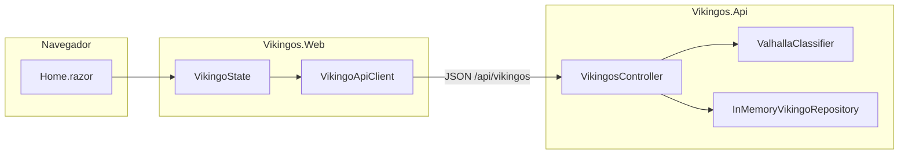

# Vikingos

Aplicación web para la gestión de vikingos y su ingreso al Valhalla. La interfaz es Blazor Server y consume un Web API de ASP.NET Core. Los datos viven en memoria mientras el proceso de la API está en ejecución.

## Requisitos

- .NET SDK 10
- Certificado de desarrollo HTTPS: `dotnet dev-certs https --trust`

## Ejecutar

Desde la raíz del repositorio, en dos terminales:

```bash
dotnet run --project src/Vikingos.Api --launch-profile https
dotnet run --project src/Vikingos.Web --launch-profile https
```

- API: `https://localhost:7169`
- Blazor: `https://localhost:7170`
- Contrato OpenAPI: `https://localhost:7169/openapi/v1.json`

## Endpoints

| Método | Ruta | Respuesta |
| --- | --- | --- |
| GET | `/api/vikingos` | 200 y la lista |
| GET | `/api/vikingos/{id}` | 200 o 404 |
| POST | `/api/vikingos` | 201 y el vikingo creado |
| PUT | `/api/vikingos/{id}` | 200 o 404 |
| DELETE | `/api/vikingos/{id}` | 204 o 404 |

Un cuerpo inválido responde 400.

## Reglas de Valhalla

Lo que se guarda es el formulario: nombre, batallas ganadas, arma favorita, nivel de honor y causa de muerte gloriosa. Puntos, categoría y el banquete se calculan en cada lectura.

Puntos = `batallas ganadas * 10` más honor: Bajo 0, Medio 40, Alto 80.

Categoría, en este orden:

1. **Guerrero de Thor** si las batallas ganadas son 40 o más.
2. **Guerrero de Odín** si el honor es Alto y las batallas son menos de 40.
3. **Guerrero de Freyja** en cualquier otro caso.

El mensaje "¡Listo para el banquete en Valhalla!" aparece cuando el honor es Alto y los puntos son 150 o más.

Armas: hacha, espada, martillo. Causas de muerte: batalla en campo abierto, duelo uno contra uno, protegiendo su aldea.

## Arquitectura

La solución tiene tres proyectos: `Vikingos.Web` (Blazor Server), `Vikingos.Api` (Web API) y `Vikingos.Api.Tests`. El navegador mantiene un circuito SignalR con la web. La web llama a la API por HTTPS. La API no tiene base de datos: la lista vive en memoria mientras el proceso está en ejecución.



`Home.razor` dibuja la lista y el formulario, y se suscribe a `VikingoState`. Ese estado, uno por circuito, llama a `VikingoApiClient`. El controlador traduce el JSON a la entidad, la guarda en el repositorio y, al responder, pide puntos, categoría y banquete a `ValhallaClassifier`.

## Diseño del backend

La API separa el contrato HTTP, el caso de uso, las reglas de Valhalla y el almacenamiento. La clasificación la calcula `ValhallaClassifier`. El repositorio solo guarda y devuelve entidades.

| Capa | Tipos | Responsabilidad |
| --- | --- | --- |
| Contrato | `VikingoRequest`, `VikingoResponse` | Entrada y salida JSON. La petición se valida. La respuesta añade lo calculado. |
| Aplicación | `VikingosController` | CRUD, códigos HTTP y el mapeo entre contrato y entidad. |
| Dominio | `ValhallaClassifier`, `Clasificacion` | Puntos, categoría y banquete. Sin estado y sin acceso al repositorio. |
| Persistencia | `IVikingoRepository`, `InMemoryVikingoRepository`, `Vikingo` | Lista en memoria. Guarda solo los datos del formulario. |

`Program.cs` registra el repositorio y el clasificador como singleton. El clasificador solo depende de las batallas y del honor. El repositorio comparte la misma lista entre todas las peticiones y la protege con un `Lock`. Cada lectura y cada escritura devuelve una copia, así quien llama no modifica la lista interna.

Al crear un vikingo el repositorio asigna un `Guid` nuevo. Al arrancar carga tres registros de ejemplo: Ragnar, Astrid y Floki. Si el proceso se detiene, esos datos y los creados después desaparecen.

`Vikingo` guarda identificador, nombre, batallas, arma, honor y causa de muerte. `ValhallaPoints`, `Categoria` y `ListoParaElBanquete` se calculan en `ToResponse` en cada lectura y en cada escritura. Las reglas están en la sección anterior.

Los enumerados viajan como texto (`Hacha`, `Alto`, `Thor`) con `JsonStringEnumConverter`. Si `VikingoRequest` no cumple las anotaciones, ASP.NET Core responde 400 y el vikingo no se guarda. Un `id` que no existe responde 404. Un borrado correcto responde 204.

En desarrollo el contrato queda publicado en `/openapi/v1.json`.

## Diseño del frontend

Blazor Server con renderizado interactivo. La pantalla de trabajo es `Home.razor`, dentro de `MainLayout`. Las llamadas HTTP pasan por `VikingoState`.

| Pieza | Ámbito | Responsabilidad |
| --- | --- | --- |
| `Home.razor` | componente | Lista, formulario, confirmación de borrado y el panel de reglas. |
| `VikingoState` | circuito (`scoped`) | Lista, formulario, carga, error, edición y borrado pendiente. |
| `VikingoApiClient` | cliente HTTP tipado | GET, POST, PUT y DELETE. Convierte fallos de red y de contrato en `VikingoApiException`. |
| `VikingoFormModel` | modelo del formulario | Las mismas reglas que `VikingoRequest`, evaluadas antes de enviar. |
| `Etiquetas` | estático | Textos visibles de armas, honor, causas y categorías. |

`VikingoState` publica los cambios con el evento `OnChange`. `Home` se suscribe en `OnInitializedAsync`, llama a `StateHasChanged` y se desuscribe al salir de la página.

Crear, editar y borrar siguen el mismo camino: la página dispara la acción, el estado marca `Cargando`, el cliente llama a la API y, si la respuesta es correcta, el estado actualiza la lista del circuito. Crear añade el vikingo devuelto. Editar sustituye el del mismo `Id`. Borrar lo quita. Un 404 vuelve a pedir `GET /api/vikingos` para alinear la lista con el servidor. Un fallo de red, un JSON inesperado o un 400 dejan el mensaje en `Error`, y la página lo muestra en la alerta.

El formulario es un `EditForm` con `DataAnnotationsValidator`. `FormularioToken` cambia al guardar o al cancelar, y vuelve a montar el formulario para que los mensajes de la edición anterior no se queden en pantalla. La dirección de la API sale de `ApiBaseUrl` en `appsettings.json`.

## Pruebas

```bash
dotnet test Vikingos.sln
```
